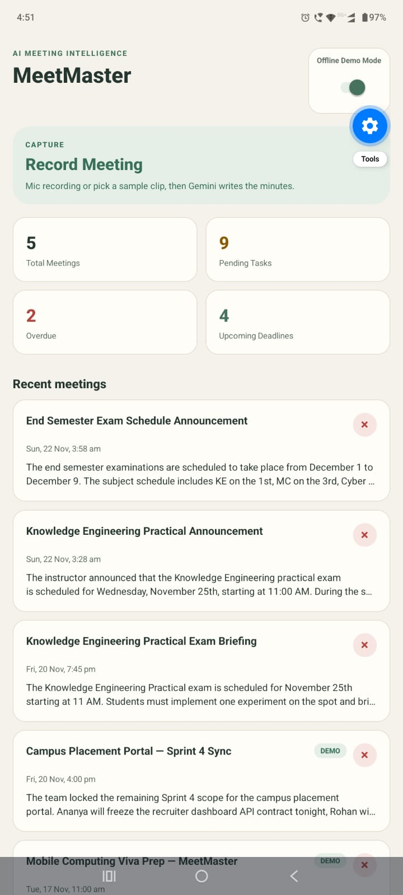
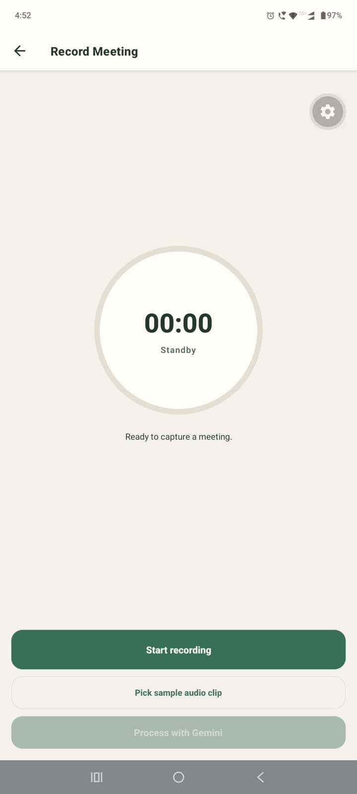
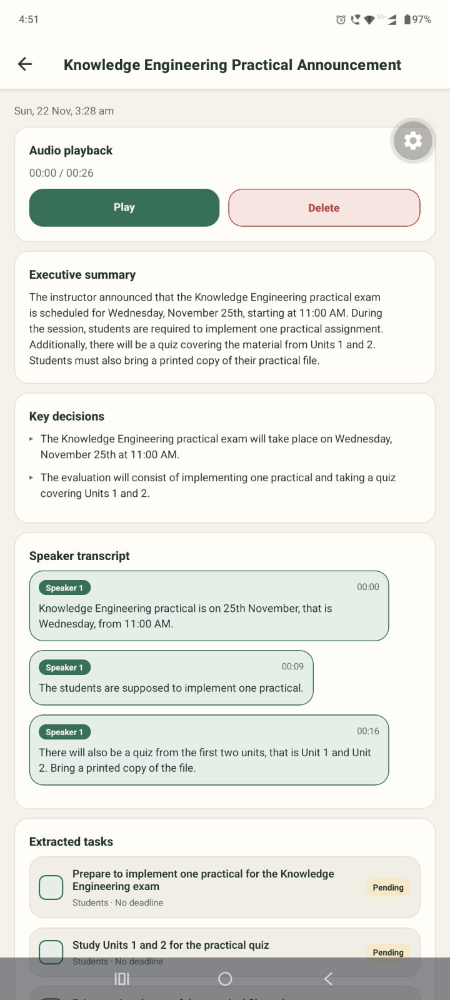

# MeetMaster

**Turn messy conversations into clear actionable decisions.** MeetMaster is a cross-platform meeting assistant that records or imports audio, uses Google Gemini to create meeting minutes, and helps teams follow through with decisions, owners, deadlines, and reminders.

## Highlights

- **From audio to action:** Convert a recording into a summary, decisions, speaker transcript, and assigned tasks.
- **Ask the meeting:** Get concise answers grounded in the saved meeting notes and transcript.
- **Keep work moving:** Track pending, completed, overdue, and upcoming action items.
- **Export the meeting in a PDF in seconds:** Convert the speaker notes, transcript and tasks to do in a PDF instantly using built-in feature.
- **Demo-ready:** Explore included sample meetings without needing a Gemini key.
- **Made for mobile:** Built with Expo and React Native, with a web preview for browser use.

## Screenshots

<p align="center">
  
  
  
</p>

<p align="center"><em>Screenshots from the MeetMaster mobile app.</em></p>

## Features

- **Record meetings** — Capture microphone audio with start, pause, resume, and stop controls.
- **Import audio** — Choose an audio clip from the device to process.
- **Generate minutes of the meeting** — Use Gemini to produce a summary, decisions, speaker segments, and action items.
- **Ask meeting questions** — Query a meeting’s saved notes and transcript with AI.
- **Track action items** — View owners and deadlines, then mark tasks pending or completed.
- **View meeting insights** — See counts for meetings, pending tasks, overdue work, and upcoming deadlines.
- **Schedule reminders** — Create local notifications for eligible future task deadlines.
- **Export minutes** — Share or print a PDF containing the meeting summary, decisions, transcript, and tasks.
- **Explore demo meetings** — Review bundled examples with transcripts and tasks, even without Gemini credentials.
- **Delete meetings** — Remove a meeting and its saved recording from the app.
- **Save locally** — Persist meetings and task status on the current device.

## Tech stack

| Area | Technology |
| --- | --- |
| App | JavaScript, React 19, React Native 0.88, Expo SDK 58 |
| Navigation | React Navigation native stack |
| Web support | React Native Web |
| AI | Google Gemini REST API |
| Local data | AsyncStorage |
| Audio and file selection | `expo-audio`, `expo-file-system`, `expo-document-picker` |
| Reminders | `expo-notifications` |
| PDF and sharing | `expo-print`, `expo-sharing` |
| Safe areas and status bar | `react-native-safe-area-context`, `expo-status-bar` |

## Installation and setup

### Requirements

- Node.js and npm
- Expo Go on a physical Android or iOS device, or a supported emulator
- A Google Gemini API key for AI Q&A and audio processing

### Install

```bash
git clone https://github.com/Pre-rana/MeetMaster.git
cd MeetMaster
npm install
```

Create a local environment file:

```bash
# macOS / Linux
cp .env.example .env
```

```powershell
# Windows PowerShell
Copy-Item .env.example .env
```

Add your Gemini key to `.env`:

```env
EXPO_PUBLIC_GEMINI_API_KEY=your_gemini_api_key
```

Start the app:

```bash
npx expo start
```

Scan the QR code with Expo Go, or press `a` or `i` in the Expo terminal to launch an Android or iOS emulator. Press `w` to open the web version. If the phone cannot reach the development server over the local network, try:

```bash
npx expo start --tunnel
```

After changing `.env`, restart the Expo development server so the updated variable is loaded.

## Demo walkthrough

1. Launch the app and leave **Offline Demo Mode** enabled to load the included sample meetings.
2. Open a sample meeting and explore its summary, decisions, speaker transcript, and extracted tasks.
3. Mark an action item completed, then switch between the **Pending** and **Completed** filters.
4. Export the sample meeting’s minutes as a PDF; this uses the saved meeting data and does not require Gemini.
5. To demonstrate AI, configure the Gemini key and internet access, then ask a question such as **“Who owns what?”**
6. To demonstrate the complete capture flow, record a short clip or import an audio file and select **Process with Gemini**.

## Important notes

- **Demo mode is not full offline AI.** Sample meetings, task tracking, and PDF export work locally; Gemini Q&A and audio processing require internet access and a configured key.
- **Protect your API key.** `EXPO_PUBLIC_GEMINI_API_KEY` is bundled into the client app and is visible to users. It is suitable only for development or controlled demos; use a secure backend proxy with authentication and rate limits for a public production release.
- **Audio is sent to Gemini for processing.** Get appropriate consent before recording or uploading conversations, and review generated minutes for accuracy.
- **Grant permissions when prompted.** Recording requires microphone access; Android 13 and later may also require notification permission.
- **Data is device-local.** Meetings are stored with AsyncStorage; there is no account, cloud database, or cross-device synchronization.
- **AI results can be imperfect.** Verify speaker labels, decisions, owners, and dates before relying on them.
- **PDF behavior differs by platform.** Native devices use the system share or print interface; web opens the browser print dialog, where you can choose Save as PDF.
- **Expo Go notification delivery can vary.** Test reminders on the target device before relying on them for an important deadline.

---

Wishing you clearer meetings, calmer follow-ups, and more time for the work that matters.
